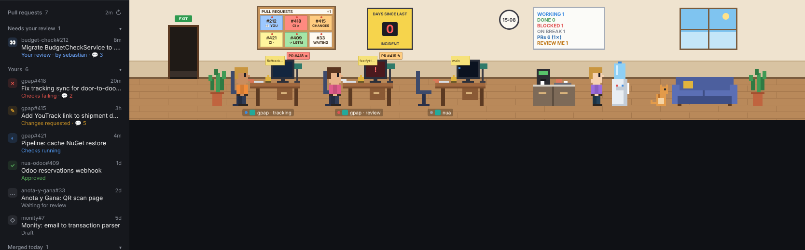

# GitHub watcher for Herdr Office

An addon for [DustyPolk/herdr-office](https://github.com/DustyPolk/herdr-office) that keeps an eye on all your open pull requests on GitHub, and the ones waiting on your review.



*(The preview is an approximate render made outside Herdr.)*

- **Sidebar list.** "Pull requests" sits under Spaces, most urgent first: reviews asked of you, then checks failing, conflicts, changes requested, checks running, approved, waiting, drafts.
- **Corkboard on the office wall.** Each PR gets an index card, colored by what it's waiting on. Click a card to open the PR.
- **Desk flags.** An agent working on a branch with an open PR gets a "PR #n" flag on its monitor.
- **Toasts.** You get a toast when checks fail or pass, a PR is approved, changes are requested, a conflict appears, someone requests your review, or a PR merges.
- **Merges.** A merge shows a 🎉 banner in the office and counts toward the pizza party.
- **🤖 on a row.** Hands the PR to an agent in a new tab. Your own PRs go to Claude (fix CI, resolve conflicts, address reviews). Review requests go to Codex (a read-only review).
- **`ctrl-shift-g`** opens the full list as a dialog while the office layout is shown.

## Install

You need the [GitHub CLI](https://cli.github.com) signed in: `winget install GitHub.cli`, then `gh auth login`.

**With the script (Windows):**

```powershell
powershell -ExecutionPolicy Bypass -File .\install.ps1
```

It installs into `%USERPROFILE%\.config\herdr-app` (or `$env:HERDR_APP_HOME`, or `-HerdrHome <folder>`). It does the following, keeping a `.bak-<time>` of anything it changes:

1. Copies `mods/office-prs`.
2. Adds `mods/office/prs.js`.
3. Updates the office's `main.js`. An unmodified upstream copy is replaced. If you've changed yours (WEATHER on, say), it applies `patches/office-main.patch` instead, so your changes stay.
4. Adds the Pull requests block to `layouts/office.json`.
5. Binds `ctrl-shift-g` in `keys.json`.
6. Checks `gh` and runs `herdr-app check` on both mods.

**To roll back:** `powershell -ExecutionPolicy Bypass -File .\uninstall.ps1`. It restores `main.js`, `office.json` and `keys.json` from the backups the install made (or takes the changes out if there are none), then deletes `mods/office-prs` and `mods/office/prs.js`. The files it replaces are kept as `*.removed-<time>`.

**By hand, or by asking your Herdr agent** ("add the mod in C:\Github\github-watcher-herdr; read RECIPE.md"):

1. Copy `mods/office-prs/` into `~/.config/herdr-app/mods/`.
2. Copy `mods/office/prs.js` into your `mods/office/`, and apply `patches/office-main.patch` to its `main.js` (`git apply -p1 patches/office-main.patch` from the herdr-app folder). If you never changed the office, you can copy `mods/office/main.js` over instead.
3. Add this after the `spaces` block in `sidebar-lists` in `layouts/office.json`:

   ```json
   { "id": "prs", "type": "block", "content": { "mod": "office-prs" }, "size": { "weight": 1 }, "min": 90 }
   ```

4. Add `"ctrl-shift-g": "mod.open:office-prs"` to the `layout:office` section of `keys.json`.
5. Run `herdr-app check` on `mods/office-prs` and `mods/office`.

## Settings

These live in `mods/office-prs/settings.js`. The installer creates that file once and never overwrites it.

| Setting | Default | What it does |
|---|---|---|
| `POLL_EVERY` | 2 min | How often it asks GitHub |
| `NOTIFY` | `true` | Toasts on changes |
| `HOST` | `null` | GitHub Enterprise host, e.g. `"github.mycompany.com"` |
| `FILTER` | `""` | Extra search terms for every account, e.g. `"org:my-org"` or `"-repo:me/dotfiles"` |
| `ACCOUNTS` | `[]` | Several GitHub accounts at once (see below). Empty: `gh`'s active account |
| `FIX_WITH` | `["claude"]` | Agent for your own PRs |
| `REVIEW_WITH` | `["codex"]` | Agent for review requests |

### Several GitHub accounts (e.g. personal for PAP, work for Iron)

`gh` can hold more than one account per host, with one of them active. The watcher reads each account's token from `gh` and queries as that account, so all of them are watched at once whichever is active.

1. Add the second account: `gh auth login` (pick GitHub.com and sign in with the other account). `gh auth status` should list both.
2. Check that both tokens work (replace the logins with yours):
   ```powershell
   gh api user -H "Authorization: token $(gh auth token --user WORK-LOGIN)" --jq .login
   gh api user -H "Authorization: token $(gh auth token --user PERSONAL-LOGIN)" --jq .login
   ```
   Each should print its own login.
3. List them in `settings.js`:
   ```js
   export const ACCOUNTS = [
     { user: "PERSONAL-LOGIN", label: "PAP", filter: "org:PAP-ORG" },
     { user: "WORK-LOGIN", label: "Iron", filter: "org:IRON-ORG" },
   ];
   ```
   `filter` narrows that account's lists. Each PR gets its label as a chip in the list.

If one account fails (signed out, token expired), the others keep updating. The failing one keeps its last lists, and the error names it.

**Two things the watcher doesn't change:**
- **Which account `git push` uses.** That's your Git credential setup.
- **Which account your browser is signed in to.** A private Iron PR opened from the list needs a browser that's signed in to the work account.

## Network and programs

- It runs `gh` only: `gh api` to read, and `gh pr view --web` when you click.
- The only network traffic is `gh` talking to GitHub with your own credentials.
- The 🤖 button starts the agent you configure, in a new tab.

Read [RECIPE.md](RECIPE.md) for the full brief.

## Tests

`tests/` has a Node harness. It stubs `herdr` and `gpui-kit`, checks every element method against gpui-kit's names, and tests the GitHub parsing, change detection, toasts, hand-off and office hooks:

```sh
node --import ./tests/register.mjs tests/test.mjs
```

## License

MIT. The office mod files are © DustyPolk (MIT), with the PR hooks added.
