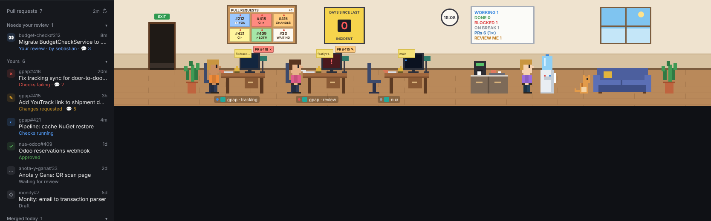

# Office PRs

An addon for the [Office](https://github.com/DustyPolk/herdr-office) layout that keeps an eye on every pull request you have open on GitHub, plus the ones waiting on your review. A **Pull requests** list sits in the sidebar under Spaces. A corkboard on the office wall pins an index card for each PR, colored by what it's waiting on. Any agent whose branch has an open PR gets a little flag on its monitor. When something changes (checks fail or pass, a reviewer approves or asks for changes, a conflict appears, someone asks for your review, a PR merges) you get a toast, and a merge also gets a banner in the office and counts toward the pizza.

## What you see

**The sidebar list** (`office-prs` in the `sidebar-lists` column, under `spaces`, weight 1, min 90px), drawn on the theme's `chrome`:

- A 41px header: "Pull requests" with the count (11.5px, `dim`), how long ago it last checked ("2m", or "checking…"), and a ↻ button that checks now.
- An error box when `gh` fails (tinted `blocked`, 11.5px).
- **Needs your review**: other people's PRs that request your review.
- **Yours**: your open PRs.
- **Merged today**: at 70% opacity.

  Each section header (11px, `dim`) folds its section when clicked. Rows run most urgent first:
  - left: a 20px rounded badge tinted by state
  - top line: `repo#123` and the age (11px, `dim`)
  - the title (12.5px, `foreground`)
  - a status line in the state's color: label, ✓ approvals, "by author" (on reviews), 💬 comments
- **Rail.** Narrower than 160px (a folded sidebar), the list shrinks to one 28px tile with the count, colored by the most urgent PR. Clicking the tile opens the dialog.
- **Dialog** (`mod.open office-prs`, `ctrl-shift-g` in the office layout): 600px wide, 75% tall, on `popover`, with full `owner/repo#123` and `+additions −deletions`, and a ✕.

**States**, in urgency order:

| State | When | List color | Card |
|---|---|---|---|
| review | someone asked for your review | `accent` | 👀 YOU, `#9cc8ff` |
| failing | checks FAILURE/ERROR | `blocked` | CI ✗, `#ff8a80`, blinking |
| conflict | mergeable CONFLICTING | `ansi5` | CONFLICT, `#d7a8ff`, blinking |
| changes | CHANGES_REQUESTED | `ansi3` | CHANGES, `#ffcc80` |
| running | checks PENDING/EXPECTED | `working` | CI ·/··/···, `#fff59d` |
| approved | APPROVED | `done` | ✓ LGTM, `#a5e6a8` |
| waiting | none of the above | `dim` | WAITING, `#fffaf0` |
| draft | draft | `dim` | DRAFT, `#d9d4c8` |

**In the office** (`mods/office/prs.js`):

- **Corkboard.** It hangs in place of the first wall window it fits beside (clear of the door and the kitchen), 164px wide and up to 100px tall.
  - Cork `#c8955c` in a `#7a5c3e` frame, with a paper header "PULL REQUESTS" and "+N" when not everything fits.
  - Up to 6 index cards: 3 across, 2 rows when the wall is at least 76px tall, otherwise 1. Each card has a red pin, `#number` and the state label.
  - "INBOX ZERO ✨" with nothing open.
  - A note "gh needs a hand" when `gh` fails and there's nothing to show.
  - At 75% opacity when the data is over 30 minutes old.
- **Desk flags.** An agent whose pane's git branch matches one of your PRs' head branch gets a flag on top of its monitor: "PR #123" plus a mark (✗ ⚠ ✎ ✓ … ◇), in the card's color. Branches `main`, `master`, `develop`, `dev`, `trunk`, `staging`, `production` and `release` are never matched.
- **Whiteboard.** "PRs n (k✗)" in `#2b6cb0` and "REVIEW ME n" in `#c07a1a`, each only when nonzero.
- **Merge banner.** "🎉 MERGED repo#123" in `#2f9a50` for 60 seconds, in the season-banner spot.

## How it behaves

- **Polling.** Every 2 minutes (`POLL_EVERY`), one GraphQL call through `gh` fetches both lists. When your PRs leave the open list, a second small call asks GitHub which of them merged.
- **One poller.** Any copy may poll (sidebar, dialog), but a shared lease means only one does at a time. Only the copy that polled posts toasts.
- **Opening the dialog** refreshes if the data is over a minute old.
- **Toasts.** Shown on changes since the last poll, never on the first poll:
  - checks failed (error) and checks passed (success)
  - approved (success)
  - changes requested (warning)
  - merge conflict (warning)
  - review requested (info)
  - merged (success)

  At most 4 at once, then "N more". Clicking a toast opens the dialog.
- **Click a row, card or desk flag** to open the PR in the browser (`gh pr view <url> --web`). Clicking a flag or card doesn't also focus the desk.
- **Hover a row** to show 🤖. Clicking it opens a new tab named "PR #n" (`tab.new`) with an agent and a first message:
  - Review requests go to `REVIEW_WITH` (`codex`), with a read-only review task.
  - Your own PRs go to `FIX_WITH` (`claude`), with a task to fix CI, resolve conflicts, address review comments, or report status, always in a new git worktree and asking before pushing.

  The tab opens in the space whose pane's folder path contains a folder named like the repo, at that folder. Without a match it opens in the current space, with a toast saying so.
- **Merges in the office.** A merge made after the office opened shows the banner and counts as a finish toward the pizza party (3 finishes in 5 minutes).
- **Without office-prs.** If `shared("office.prs")` is empty, the office looks exactly as before.

## Built from

- `mods/office-prs/github.js`:
  - `fetchAll` runs `gh api user --jq .login` once, then `gh api graphql` with two aliased `search(type: ISSUE)` queries: `is:pr is:open archived:false author:<login>` and `review-requested:<login>`, both `sort:updated-desc` plus `FILTER`.
  - Fields per PR: `isDraft`, `reviewDecision`, `mergeable`, `commits(last:1).statusCheckRollup.state`, `latestReviews`, `reviewRequests`, `comments.totalCount`, `headRefName`, `additions`, `deletions`.
  - Merged check: `nodes(ids: [...]) { ... on PullRequest { merged } }`.
  - `stateOf`, `parse`, `changes` and `gone` are pure.
- `mods/office-prs/settings.js`: `POLL_EVERY`, `NOTIFY`, `HOST`, `FILTER`, `ACCOUNTS`, `FIX_WITH`, `REVIEW_WITH`. `install.ps1` never overwrites it.
- `mods/office-prs/main.js`: the View. It uses `exec` (through github.js), `shared`, `setShared`, `notify`, `run("tab.new" | "mod.open")`, `closeOverlay`, `panes()`, `spaces()` and `theme()`. Timer: every 30s (staleness check and the "ago" labels).
- `mods/office-prs/mod.json`: `{ "place": "none", "overlay": { "kind": "dialog", "width": 600, "height": 0.75 } }`.
- **Shared state:**
  - `office.prs`: `{ v, at, host, login, error, mine[], review[], merged[] }`. Each PR is `{ id, kind, account, repo, number, title, url, branch, author, draft, checks, decision, mergeable, comments, additions, deletions, approvals, waitingOn, createdAt, updatedAt, state }`. `merged` holds the last 20 merges within 7 days.
  - `office.prs.lease`: `{ by, until }` while polling.
- `mods/office/prs.js`, read by the office's `main.js`. Hooks:
  - `room()`: the board replaces the first window slot it fits in.
  - The whiteboard rows.
  - `deskAt(..., pr)`: the flag.
  - `track()`: merges as finishes, and the banner.

  The diff is `patches/office-main.patch`.
- `layouts/office.json`: `{ "id": "prs", "type": "block", "content": { "mod": "office-prs" }, "size": { "weight": 1 }, "min": 90 }` after `spaces` in `sidebar-lists`.
- `keys.json`: `"layout:office": { "ctrl-shift-g": "mod.open:office-prs" }`.
- **Programs:** `gh` only. The network goes through `gh`, to GitHub. With the 🤖, it runs the agent you configure.

## Watch out

- You need `gh` installed and signed in (`gh auth login`). By default it watches the active account for `HOST` (github.com, or a GitHub Enterprise host if you set one).
- `ACCOUNTS` in `settings.js` watches several accounts at once:
  - Each `{ user, label, filter }` gets its token from `gh auth token --user <user>`. Herdr's `exec` can't set `GH_TOKEN`, so the token goes in as `gh api -H "Authorization: token …"`.
  - The lists merge, and each PR is tagged with its account's label.
  - One account failing keeps its last lists, and its error is prefixed with the label.
- `review-requested:` includes team requests. Use `user-review-requested:` in the query for only direct ones.
- `mergeable` is `UNKNOWN` until GitHub computes it, so a conflict can show one poll late.
- Search returns at most 50 of yours and 30 reviews.
- Mods keep running while their block is in the layout, even hidden. Without the sidebar block, the office board only refreshes while the dialog is open.
- Desk flags match by branch name only. Two repos with the same branch name pick the first PR.
- The office's README says it "runs no programs". With this addon, clicking a card or flag runs `gh pr view --web`.
- `herdr-app check` renders with empty shared state, so it can't exercise the list. Try it with real PRs.

## Done when

- The sidebar shows "Pull requests" with your open PRs. A PR with red checks has a red ✗ badge and "Checks failing".
- A PR that requests your review appears under "Needs your review" with 👀.
- The office wall has the corkboard with a card per PR. Clicking a card opens the PR in the browser.
- An agent on a branch with an open PR shows "PR #n" on its monitor.
- Pushing a failing commit to one of your PRs gives a "Checks failed" toast within about 2 minutes.
- Merging a PR shows "🎉 MERGED" in the office and adds a finish toward the pizza.
- `ctrl-shift-g` opens the dialog. ↻ refreshes. The 🤖 on a hovered row opens a new agent tab with the right task.
- Signing out of `gh` shows the error in the list and a "gh needs a hand" note on the board, and keeps the last lists.
